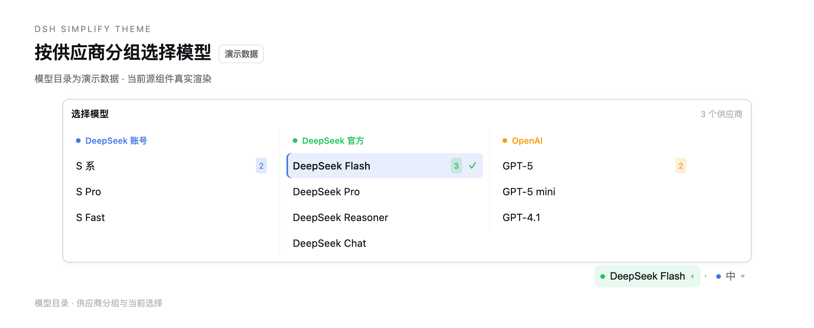
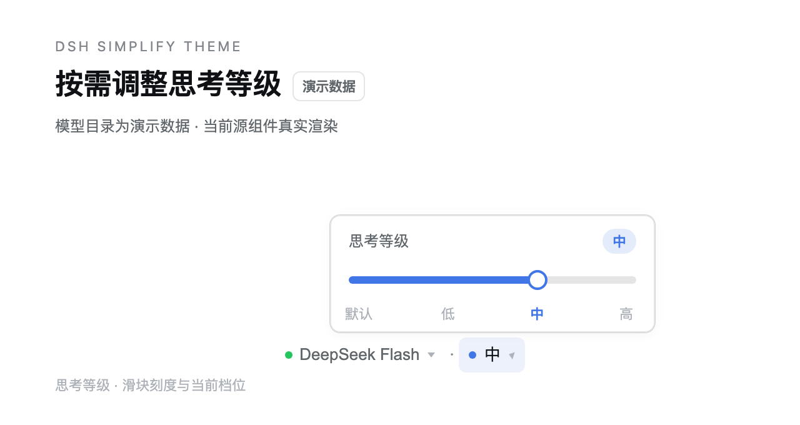
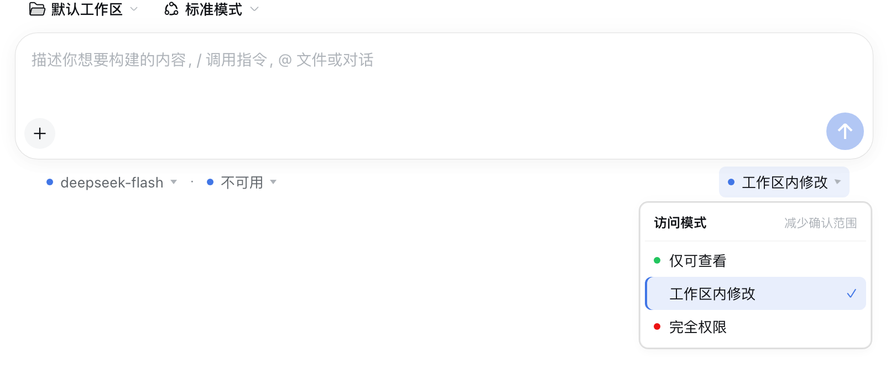
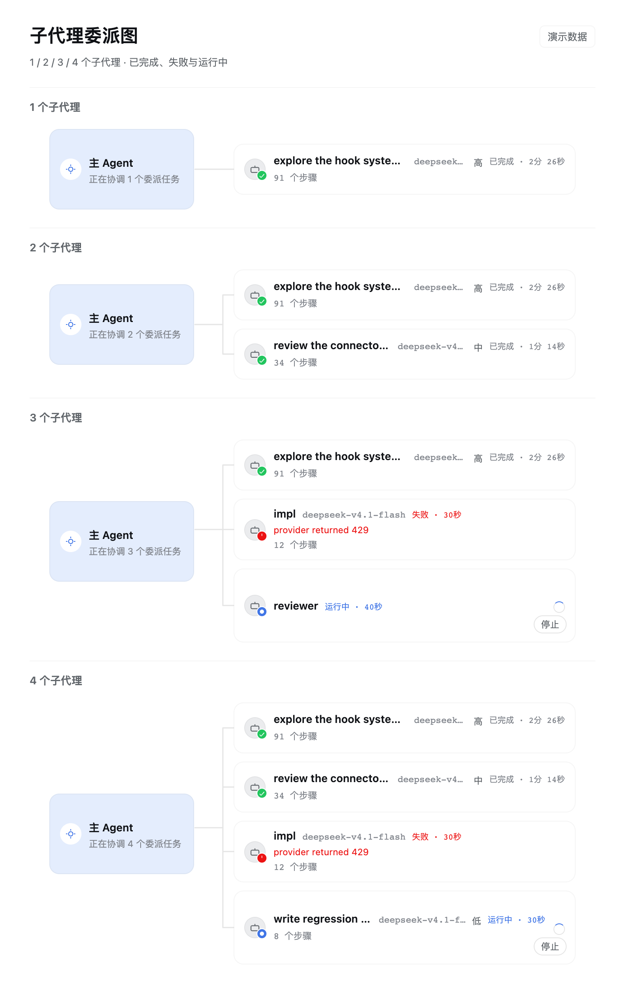
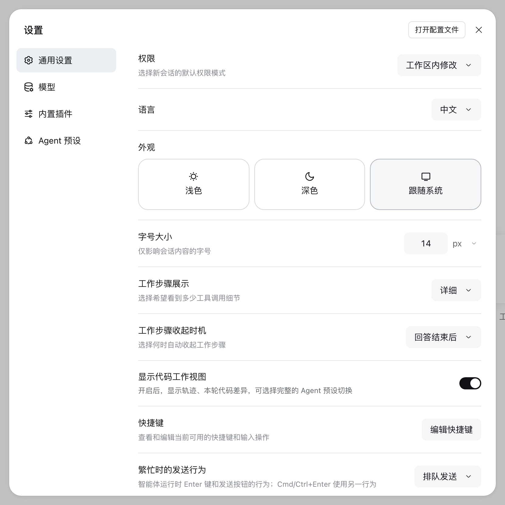
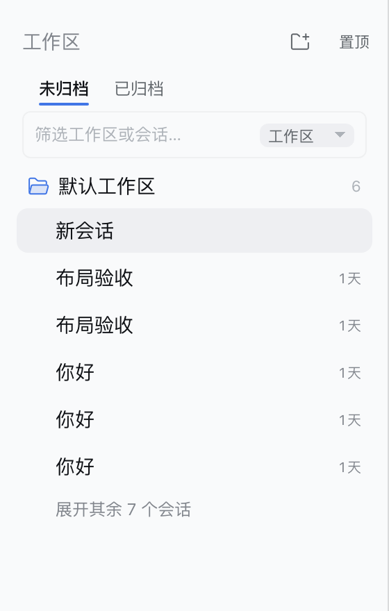

# dsh-simplify-theme

给 [DeepSeek Harness](https://github.com/deepseek-ai/deepseek-harness) 的极简主题，外加一组界面增强。

主题部分只做一件事：在当前配色之上叠一层 token，压掉装饰性噪音——去投影、去毛玻璃、
收紧圆角、气泡与交互态中性化。交互增强部分全部在浏览器侧完成，不新增 Host 行为，
禁用插件即完全还原。

- 版本：0.3.2
- 环境：DSH ≥ 0.2.0；运行时需要 `react` / `react-dom`（由宿主 ModuleLoader 提供）

## 当前界面

以下截图于 2026-10-24 重新拍摄。侧栏、权限和设置来自启用当前插件的隔离 DSH 预览；
模型、思考等级及委派图通过当前源码组件在浏览器中渲染，使用演示目录与状态，图内已注明。
截图采用浅色主题，不代表深色主题的验收结果。

模型选择按供应商分列并着色，思考等级独立展开：




权限入口在输入框右下方，模型与思考等级在左下方。隔离预览未配置模型凭据，
所以这里的思考等级显示「不可用」：



委派图的 1 / 2 / 3 / 4 个子代理布局，包含完成、运行与失败状态（演示数据）：



设置面板展示当前主题的圆角、描边与中性交互态：



## 安装

```sh
# npm
dsh plugin --profile desktop add dsh-simplify-theme

# GitHub 源码
dsh plugin --profile desktop add git+https://github.com/zdt3476/dsh-simplify-theme.git

# 本地开发目录（link）
dsh plugin --profile desktop add link:"$PWD"

# Release 里的预构建包
dsh plugin --profile desktop add https://github.com/zdt3476/dsh-simplify-theme/releases/download/v0.3.2/dsh-simplify-theme-0.3.2.tgz
```

把 `desktop` 换成你实际使用的 profile（`dsh web` 默认是 `web`）。**首次安装后需要重启 DSH**；
之后的代码改动只需 `pnpm build` + 刷新页面，不必重启整个应用——插件包是页面加载时读取的。

激活时控制台会打印一行 `[dsh-simplify-theme] 已加载构建 <版本+构建时间>`，并写到
`<html data-dsh-simplify-build>`。界面没变化时先比对这行，确认加载的是最新构建。

## 主题层

`src/client/tokens.ts` 是主题的唯一事实源，通过 `ctx.theme.overrideTokens(source, tokens)`
叠层，每个 token 给出 `{ light, dark }` 一对值。当前覆盖 25 个 token，分四组：

| 组 | 覆盖内容 |
| --- | --- |
| 圆角 | `--dsw-corner-shape` 回到 `round`；xs/sm/md/lg/xl/panel 分别为 3/6/8/12/16/20px |
| 阴影 | 四档 shadow 全部 `none`；panel/prominent/soft 三档 elevation 退化为发丝描边 |
| 菜单 | 关闭 `--dsw-menu-backdrop-filter`，菜单与分组头改不透明实底 |
| 交互与内容 | hover/active 改中性灰；气泡、引用气泡、代码块、行内代码改中性底 |

语义色（品牌蓝、状态色、焦点环）和字号一律不动，因此亮/暗/跟随系统都能直接生效。
未覆盖的 token 继承内置值，DSH 升级新增 token 时不需要跟进。

## 交互增强

以下功能全部在 Client 侧用 DOM 注入或 slot 注册实现，没有对应的 Host 代码。

### 侧栏归档分页

「工作区」标题下方两页 tab（未归档 / 已归档）。点击写回原生视图状态
`uiWorkspace.view.setArchivedFilter('default' | 'only')`，高亮从 `dsh.workspace.view.v5`
轮询同步，因此原生「视图选项」里的手动切换也能反映出来。

### 侧栏筛选行

用一个固定高度的输入行替换原生的搜索按钮与视图过滤按钮（这两个原生控件被隐藏）：

- 输入即筛选已渲染的会话/工作区行；命中会话时保留其工作区组头，命中工作区时保留组头本身
- 右侧下拉写回原生分组状态 `uiWorkspace.view.setGroupBy('workspace' | 'workspace-tree' | 'flat')`
- `Escape` 清空并收起筛选



### 工作区列表排序、置顶与折叠

- **排序**：置顶组优先，其余按「当前分页内会话的最近 `updatedAt`」降序；没有可用会话时用工作区
  `createdAt`。归档页按归档会话的时间单独计算。
- **折叠**：默认只显示最近活跃的 5 个普通工作区，更多收进「还有 N 个工作区」；置顶不占额度；
  筛选时临时展开被折叠的组。
- **置顶**：表头「置顶」按钮打开浮层（挂在 body 上，不受侧栏 `overflow: hidden` 裁剪），
  选完自动收起，`Escape` 或点外部关闭。
- **徽标**：工作区行右侧显示当前可见会话数，悬停提示同样内容。

### 输入框下方的控件条

模型、思考等级、权限三颗控件移到输入卡片下方的 dock 行：**模型与思考等级在左，权限在右**，
原生 tps / Token 用量 / 上下文统计保留在中间。

- 入口与宿主原生 seat 同规格：28px 高、13px 字号、透明底无描边，悬停或展开才出现
  浅灰底 / 品牌色淡染；模型入口带供应商色点
- **模型面板**：按供应商分列，每列一个专属色（列头色点、选中项左侧色条与勾选同色）；
  默认只显示模型名，仅当同名模型跨供应商重名时才加 `供应商 / ` 前缀，完整名称在悬停提示里
- **模型排序**：面板打开时按使用频率重排——权重 = 会话列表里用过该模型的会话数 +
  本地选择次数；没用过的供应商/模型保持原序排在后面
- **思考等级**：range 滑块带填充轨道，标题行显示当前档位，刻度文字按档位比例对齐；
  供应商未声明默认档位时保留「默认」档位；切换模型会沿用原档位，目标模型不支持时回落到它
  自己的默认档位
- **权限**：与原生选择器同源（同一 `permissionPresets.catalog` RPC、同一 `/permission` 提交通道），
  完全权限 / 自动审查保留两步确认；按风险只染色圆点，完全权限额外把文字标红
- **几何**：控件行宽度由运行时读取输入卡片实际宽度决定（`ResizeObserver` 写入
  `--dsh-simplify-card-width`），左右各内缩「卡片圆角半径」的距离与圆角末梢对齐，
  距卡片 5px、距窗口底边 16px
- 新建会话（hero）与普通会话共用同一套控件；hero 态下宿主不渲染 dock slot，由插件注入

### 缓存命中与上下文占用按值着色

- `[data-composer-stat="usage"]` 里的「缓存命中 N%」：≥80% 绿、≥50% 橙、其余红
- 上下文环的 `N%`：≤50% 绿、≤75% 橙、其余红；环的描边与数字同色

### 每轮耗时

一轮结束时在回复操作行的最右侧追加「· 耗时 12.3 秒」。计时来自会话 `running` 状态翻转的
墙钟时间（<1s 显示毫秒，>1min 显示分秒）；DOM 未就绪时按 0 / 120 / 400ms 重试写入。

### 子代理委派图

每一批委派在它发生的位置画一张单层图（结构参考 PI-Desktop 的 `SubagentTopology`）：
左侧「主 Agent」卡片 → 连接线 → 右侧子代理节点。

- 分组：同一回合内连续出现的委派算一批；中间夹了别的工具调用就另起一张
- 节点：状态角标、名称（单行省略，完整名在提示里）、模型、思考等级、状态·耗时、步数；
  失败节点红字显示错误原因（取自工具行的错误输出）；运行中节点带旋转指示与「停止」
- 状态：已完成 / 运行中 / 失败 / 已拒绝；点击节点进入对应子会话
- 连线：按真实几何绘制（SVG），主干覆盖首末分支，主 Agent 横线固定在主干正中
- 原生 `subagent` 工具行被卡片取代（`display: none`，插件禁用即恢复），同一件事不再出现两次
- 数据：会话列表快照（`origin: 'subagent'` + `parentId` + `projectionValues`）；工具行里拿不到
  子会话 id 时按快照顺序兜底认领；节点缺统计时主动调一次
  `sessions.refreshProjections(父会话)` 补齐

### 文案本地化

插件自带中英文字典并注册给宿主 locale。宿主未解析某个键（返回键名）时使用内置文案，并在
控制台告警一次，因此界面不会出现 `filter.placeholder` 这类内部键。档位名（minimal / low /
high…）与内置供应商名也做了中文映射。

## 数据与本地存储

| 键 | 用途 | 写入方 |
| --- | --- | --- |
| `dsh-simplify-theme.pinned-workspaces` | 置顶的工作区 id 列表 | 插件 |
| `dsh-simplify-theme.workspaces-expanded` | 是否展开全部工作区 | 插件 |
| `dsh-simplify-theme.usage` | 本地累计的模型选择次数（排序权重） | 插件 |
| `dsh-simplify-theme.debug` | 设为 `'1'` 时打印委派图扫描统计 | 手动 |
| `dsh.workspace.view.v5` | 归档过滤、分组方式（宿主视图状态） | 宿主；插件只调视图方法 |
| `dsh.sessions.current` | 当前会话 id（只读） | 宿主 |

本地存储只保存上述偏好与计数，不包含会话内容。清理浏览器数据会重置本地计数，排序退回
会话统计。

## 工作原理

- **Host 半**（`src/host/index.ts`）：空插件，只为让 Loader 有条目并下发 `dsh.client` 清单
- **Client 半**（`src/client/index.ts`）激活时注册五项：locale 字典、token 层、全局样式、
  侧栏注入、dock 控件；每一步用 `step()` 包裹，单步失败不影响其余功能
- Client 半打成 CJS，用 `window.__ModuleLoader__.load({ id, factory })` 包成浏览器插件包；
  React 不进 bundle，通过 `require('react')` 由宿主提供

注入依赖的稳定钩子（DSH 升级时优先检查这些选择器）：

```
[data-slot="sidebar.workspaces"]              侧栏列表插槽
[data-row-key^="workspace:"]                  工作区行
[data-slot="conversation.input.dock"]         输入区上方 dock
[data-composer-card] / [data-composer-dock]   输入卡片与控件行
[data-chat-turn] / [data-chat-node-key]       回合与聊天节点
[data-tool]                                   工具行（含 data-state）
[data-clock="end"]                            消息操作行
```

## 已知限制

- 主题只覆盖 token；组件里写死的颜色或阴影不会受影响
- Appearance 设置里没有独立主题入口，这是 DSH 当前设置 schema 的限制（本插件走 token 叠层，
  因此也不需要在设置里选择）
- 侧栏 tabs / 筛选 / 工作区排序、控件条、统计着色、回合耗时、委派图都依赖上表选择器；
  DSH 大版本更新可能需要跟进
- 委派图只画一层父子关系，不显示子代理再委派的后代；状态只区分宿主暴露的
  运行中/已完成/失败/已拒绝，`timed_out`、`aborted` 等终止态在会话行里没有稳定字段，未做推断
- 委派图依赖会话列表快照：从未打开过、且投影尚未拉取的子代理可能只显示标题与状态，
  统计会在补齐后出现；`mode: 'external'` 的子代理不会出现在快照里
- 回合耗时是运行状态的墙钟观察值，包含排队与流式等待，口径可能和原生折叠行略有差异
- 统计着色只作用于「缓存命中」标签与上下文环的百分比，其它数字不动
- dock 弹层是自绘而非 MenuSurface，键盘导航由 Escape / 外点关闭兜底

## 开发

```sh
pnpm install
pnpm test        # 类型检查 + vitest（当前 59 项）
pnpm build       # 产出 lib/index.js（Host）与 lib/client.js（Client）
pnpm check       # test + build
```

| 路径 | 作用 |
| --- | --- |
| `src/host/index.ts` | 空 Host 插件 |
| `src/client/index.ts` | Client 入口：注册字典、token 层、样式与各项注入 |
| `src/client/tokens.ts` | 主题的唯一事实源，所有覆盖值在这里 |
| `src/client/styles.ts` | 全部运行期样式（dock、侧栏、委派图、统计着色…） |
| `src/client/sidebar-*.ts` | 侧栏分页、筛选、排序/置顶/折叠 |
| `src/client/model-*.ts`、`permission-*.ts` | 模型与权限控件、目录数据、本地化映射 |
| `src/client/delegation-*.ts` | 委派图的几何、分组与节点渲染 |
| `src/client/turn-duration.ts`、`stat-colors*.ts` | 回合耗时与百分比着色 |
| `src/client/usage-*.ts` | 模型使用频率统计与排序 |
| `tests/client/` | 纯逻辑单测（token 形状、排序、解析、格式化等） |
| `cordis.patch.yml` | bundle patch，插入 `simplify-theme` 条目 |

调整主题：只改 `src/client/tokens.ts`，然后 `pnpm build` 并刷新页面。新增覆盖时注意——
key 必须是 `--dsw-*`，值必须是 `{ light, dark }`，优先引用语义 alias 而不是复制色值。

调试委派图：控制台执行 `localStorage.setItem('dsh-simplify-theme.debug','1')` 后刷新，
每次扫描会打印「工具行 N 条，兜底 M 条，会话 <id>」。

## License

MIT
