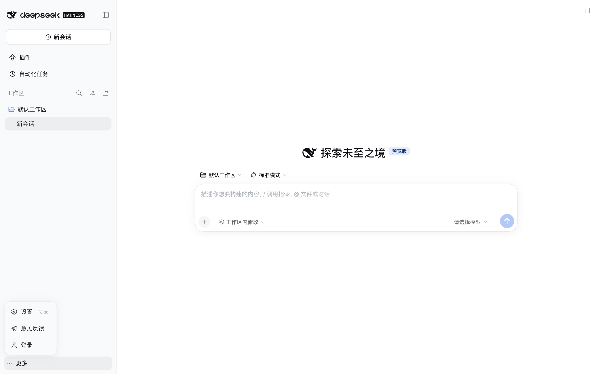
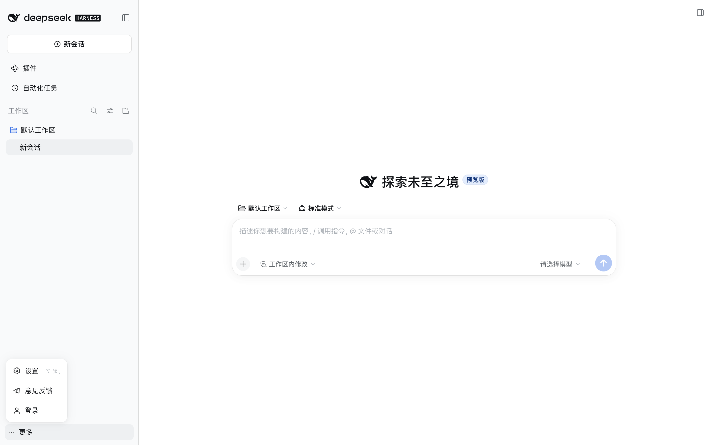
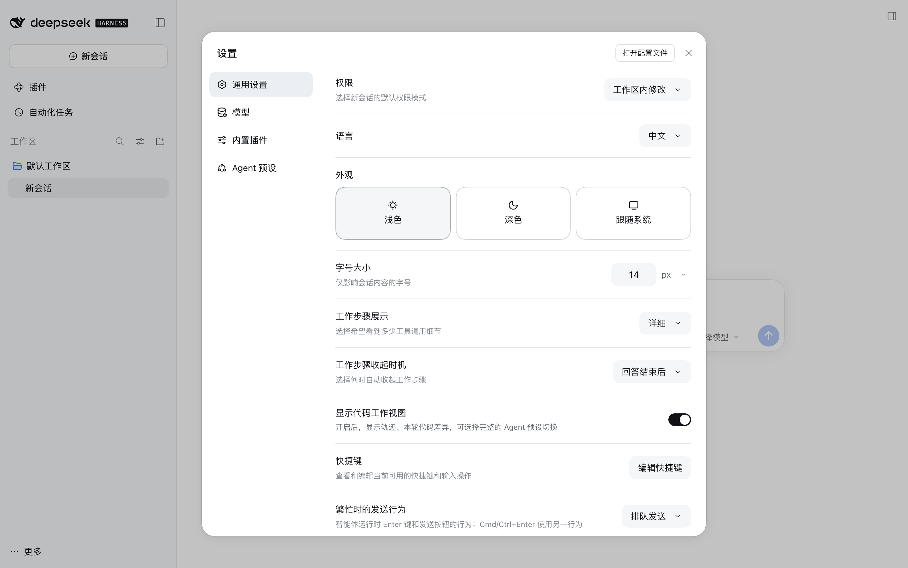
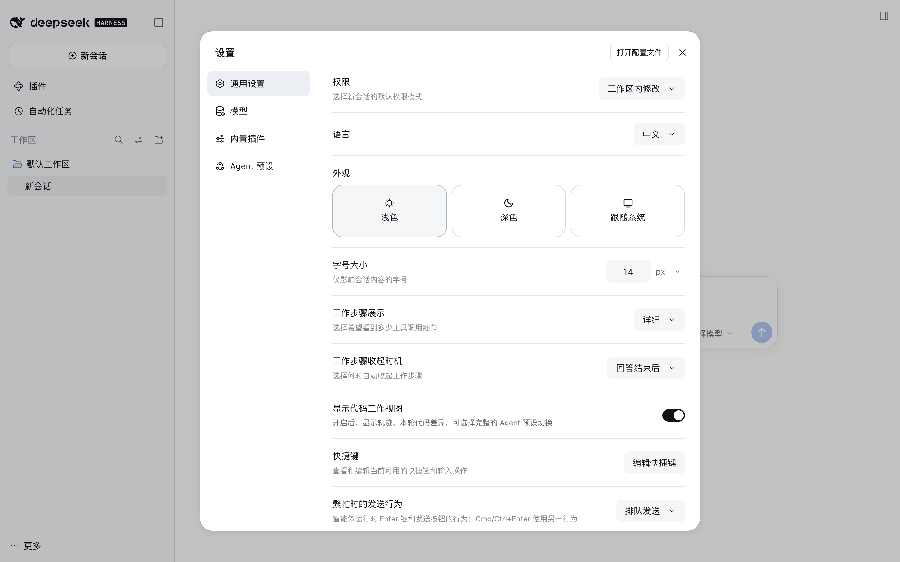
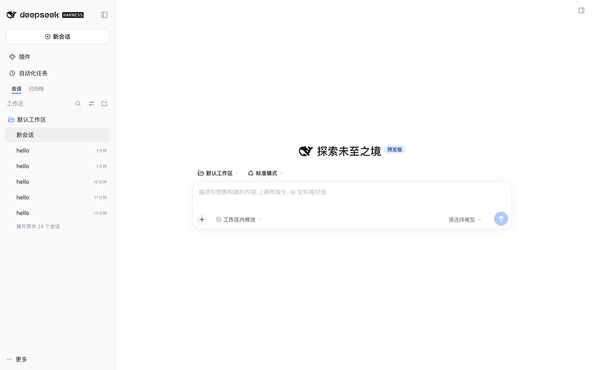
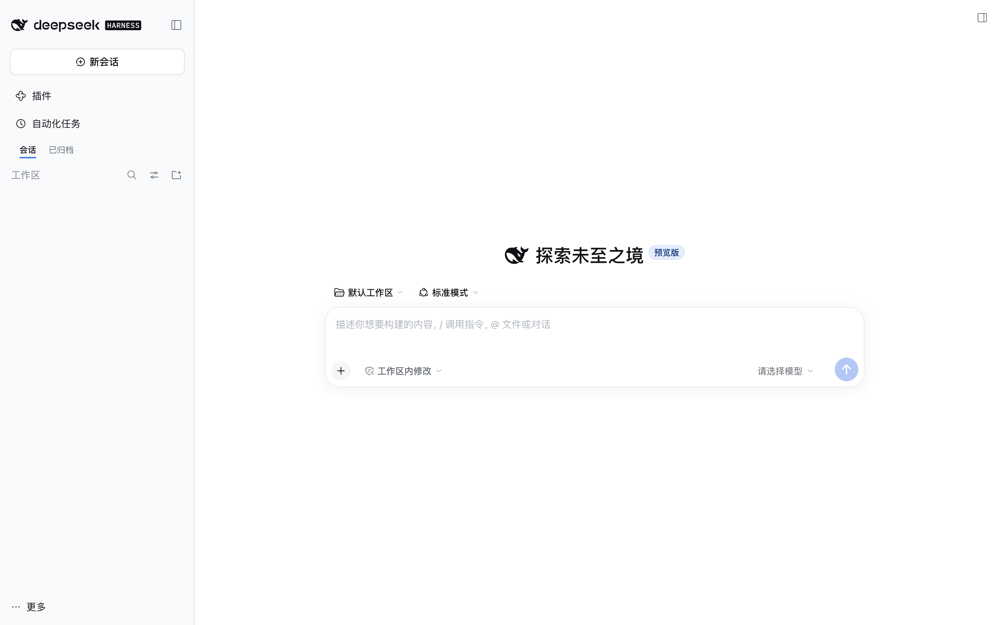
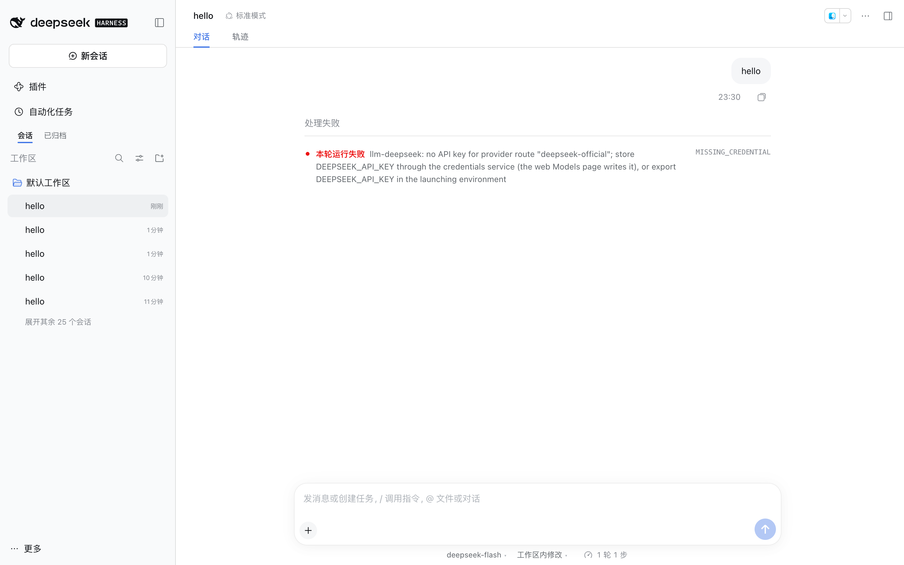
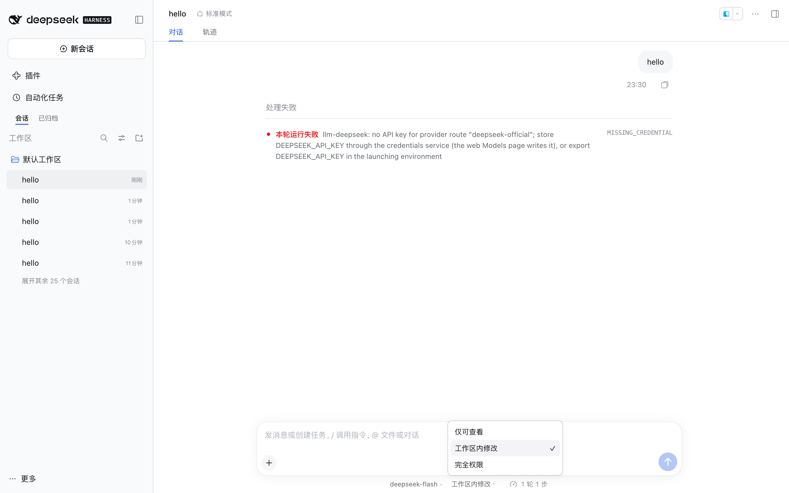

# dsh-simplify-theme

给 [DeepSeek Harness](https://github.com/deepseek-ai/deepseek-harness) 的极简主题插件。

它不改语义色、不改字号，只压掉界面里的装饰性噪音：

- 去掉全部投影，浮层只留一圈发丝描边；
- 菜单改成不透明实底，关掉毛玻璃；
- 收紧圆角，并退出 `corner-shape: superellipse`；
- 用户气泡、hover / active 改成中性灰，不再被品牌色染色；
- 代码块改用贴近画布的中性底。

亮色、暗色、跟随系统都会自动生效，因为插件是在当前配色之上叠一层
token，而不是新增一个独立主题。

## 效果对照

左为内置外观，右为启用本插件后（同一页面、同一缩放）：

| 内置外观 | 极简主题 |
| --- | --- |
|  |  |
|  |  |

最容易观察到的三处差异：菜单从半透明模糊变成不透明白底、浮层投影消失、
设置面板圆角从 28px 收到 20px。

## 功能增强

除配色皮肤外，插件还带三组交互增强：

**侧栏归档分页** — 「工作区」标题下方提供两页 tab（未归档 / 已归档），点击写回 DSH 原生的 `archivedFilter` 视图状态。

**工作区快速筛选** — 使用固定高度的输入行替代原生搜索和视图过滤按钮，旁边保留工作区 / 目录树 / 全部会话分组选择，写回原生分组状态。输入框对已渲染的会话/工作区行做 type-to-filter；命中会话时保留其工作区组头，命中工作区时保留组头本身，Escape 清空筛选。

**输入框下方控件条** — 模型、思考等级、权限三颗控件移到输入框下方的
dock 行（与上下文用量同一行），输入框内只留附件、模式和发送：

- 模型与思考等级各自独立展开；思考等级入口始终可见，展开后是带填充轨道的滑块（标题行显示当前档位、刻度标出全部档位），拖动预览、释放提交；供应商未声明默认档位时保留「默认」档位，无可调档位时说明不可用；
- 模型列表按供应商分组（默认 DeepSeek 账号/官方优先），并按真实使用频率重排——权重 = 会话列表里用过该模型的会话数 + 本地选择次数（localStorage 累计，清理历史后仍有效），没用过的保持原序排在后面；每供应商一列并配有专属强调色（列头色点、模型选中底色与勾选同色），供应商过多时自动换行、面板在视口内滚动；面板顶部显示标题与供应商数量；
- 模型入口默认只显示模型名（长名字更可读），仅当同名模型跨供应商重名时才加 `供应商 / ` 前缀；完整名称在悬停提示里；
- 切换模型会沿用原来的思考档位，目标模型不支持该档位时回落到它自己的默认档位；
- 权限控件与内置选择器同源（同一 catalog RPC、同一 `/permission`
  提交通道），完全权限/自动审查保留两步确认；
- 入口与 DSH 原生 seat 同规格：28px 高、13px 字号、透明底无描边，悬停或展开时才出现浅灰底；识别依靠供应商色点，权限按风险只染圆点（完全权限额外把文字标红）。

dock 行里的百分比统计按数值上色：缓存命中越高越绿、上下文占用越高越红，中间区间为橙色；环形进度的描边与数字同色。

**子代理委派图** — 结构复刻 [PI-Desktop](https://github.com/vastsa/PI-Desktop) 的
`SubagentTopology`：左侧「主 Agent」卡片、连接线、右侧子代理节点列表。每个节点带
头像与状态角标、名称、模型、状态·耗时、失败原因（红字）与步数；运行中的节点有
旋转指示与「停止」，节点整体可点击进入子会话。同一回合内连续的委派算一批画成一张图，
中间夹了别的工具调用就另起一张；卡片取代原生 `subagent` 工具行，不再一处信息两遍。
常驻总览由 DSH 顶部会话血缘入口承担，插件不另做列表。

本轮回答结束后，回复操作行的最右侧会追加该轮耗时（如 `· 耗时 12.3 秒`）。它按会话运行状态的墙钟时间计算，包含排队与流式等待，和原生折叠行的统计口径可能略有差异。

新建会话与普通会话使用相同的下方控件布局：模型和思考等级在卡片左下、权限在右下，控件行与输入卡片等宽（宽度按卡片实际宽度计算，任何窗口宽度下左右边缘都对齐），与卡片留 12px 间距、距窗口底边 16px；原生 tps、Token 用量和上下文统计全部保留在中间。模型/思考弹层沿卡片左缘展开，权限弹层沿右缘展开，均受视口边界约束。

工作区列表提供本地置顶菜单（浮层，不受侧栏裁剪）、可见会话数量徽标和超出 5 个工作区的折叠入口。置顶组优先，其余按当前分页内会话的最近活跃时间降序排列；没有可用会话时采用工作区创建时间。默认保留最近活跃的 5 个普通工作区，置顶不占额度，筛选时暂时展开隐藏组。徽标表示当前已渲染的会话数量，不代表全部历史数量。置顶和折叠偏好只存当前浏览器 localStorage。

| 侧栏分页 | 快速筛选 |
| --- | --- |
|  |  |
| **dock 控件条** | **权限弹层** |
|  |  |

已知限制：侧栏 tabs/筛选走 DOM 注入（WorkspaceBrowser 未暴露列表上方
slot），DSH 大版本更新可能需要跟进选择器；dock 弹层是自绘而非
MenuSurface，键盘导航由 Escape/外点关闭兜底。

## 为什么用 token 层而不是主题 id

DSH 的 `ctx.theme.register()` 可以注册第三方主题 id，但 Appearance 设置
只列 `light` / `dark` / `system` 三个内置项，注册的 id 没有选择入口，也
无法跟随系统配色。

本项目改用 `ctx.theme.overrideTokens(source, tokens)`：每个 token 给出
`{ light, dark }` 一对值，由 ui-theme 按当前配色选值，再经 ui-layout
写到 `body` 上。未覆盖的 token 全部继承内置值，因此 DSH 升级新增 token
时不需要跟进。

## 安装

插件包必须构建出 `lib/index.js`、`lib/client.js` 后才能被加载。

```sh
pnpm install
pnpm build
```

以本地 link 方式装进当前 profile（示例为 Desktop 使用的 `desktop`）：

```sh
dsh plugin --profile desktop add link:"$PWD"
```

也可以从 GUI 的 **Plugins** 页面安装本地目录。首次安装后需要重启 DSH；
之后改代码只需 `pnpm build`，再刷新界面（Web/桌面的页面刷新即可，不用重启
整个应用）——插件包是按页面加载时读取的。

激活时控制台会打印一行 `[dsh-simplify-theme] 已加载构建 <版本+构建时间>`，同时写到
`<html data-dsh-simplify-build>`；界面没变化时先比对这行，确认加载的是最新构建。

## 关闭与卸载

- 临时关闭：Plugins 页面禁用 `dsh-simplify-theme`，token 层被移除后界面
  立即还原。
- 彻底卸载：`dsh plugin --profile desktop remove dsh-simplify-theme`。

配色覆盖不修改内置外观偏好；归档 tab 使用原生视图状态，置顶和折叠偏好保存在浏览器 localStorage。插件自带中英文字典，宿主未解析某个键时会用内置文案兜底并在控制台告警一次，避免界面出现内部键名。禁用时移除界面改动，保留这些偏好以便再次启用。

## 开发

```sh
pnpm test        # typecheck + vitest
pnpm build       # 产出 lib/index.js（Host）与 lib/client.js（Client）
pnpm check       # 上面两步
```

项目结构与 [dsh-metrics](https://github.com/zdt3476/dsh-metrics) 保持一致：

| 路径 | 作用 |
| --- | --- |
| `src/host/index.ts` | 空 Host 插件，只为让 Loader 有条目并下发 `dsh.client` |
| `src/client/index.ts` | Client 入口，激活时注册 token 层，卸载时移除 |
| `src/client/tokens.ts` | 主题的唯一事实源，所有覆盖值都在这里 |
| `cordis.patch.yml` | bundle patch，插入 `simplify-theme` 条目 |
| `tests/` | token 形状与入口注册行为的单元测试 |

Client 半由 tsdown 打成 CJS，并用 `window.__ModuleLoader__.load({...})`
包成 DSH 浏览器插件包；不需要手写 bundle。

### 调整主题

只改 `src/client/tokens.ts`，然后 `pnpm build` 并重启（或等 HMR 重载）。
新增覆盖时注意：

- key 必须是 `--dsw-*`；值必须是 `{ light, dark }` 而不是裸字符串，否则
  用户切换配色后会直接不可读；
- 优先用语义 alias（如 `--dsw-alias-*`、`--dsw-specific-*`），不要直接
  改静态色板 `--dsw-static-*`；
- 能用现有 alias 引用表达的就引用（`var(--dsw-...)`），别复制色值。

## 已知限制

- 主题只做 token 覆盖，不改组件结构；某个组件写死了颜色或阴影时它不会被
  影响。
- 没有 Appearance 里的独立入口，这受 DSH 当前设置 schema 限制。
- 未覆盖的 token 保持内置值，因此这不是一套完整的第三方配色，而是叠在
  内置亮暗主题上的皮肤。

## License

MIT
